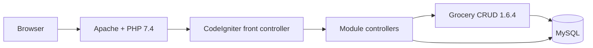
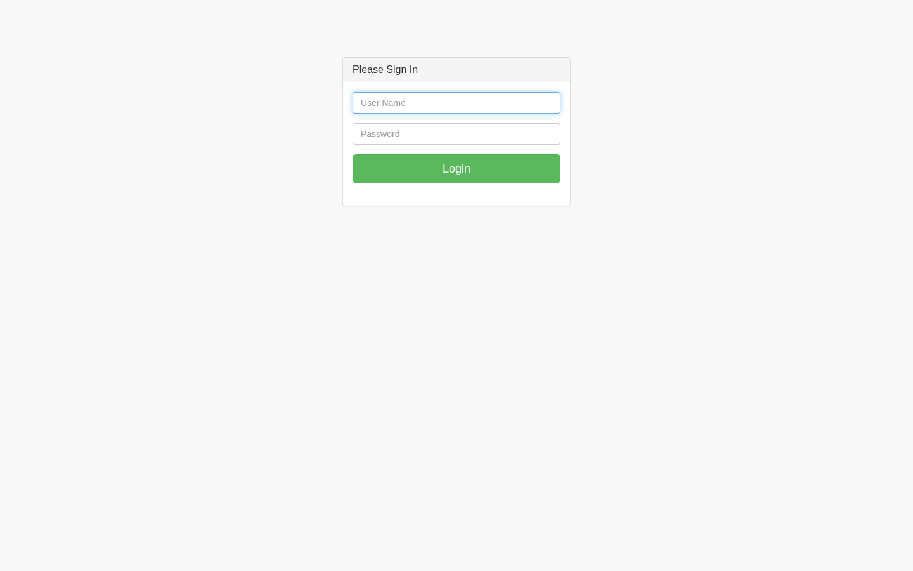
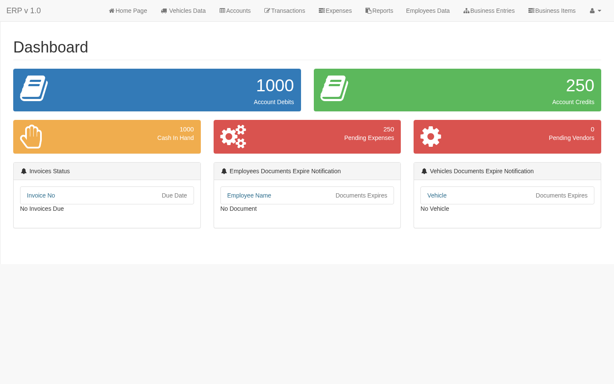
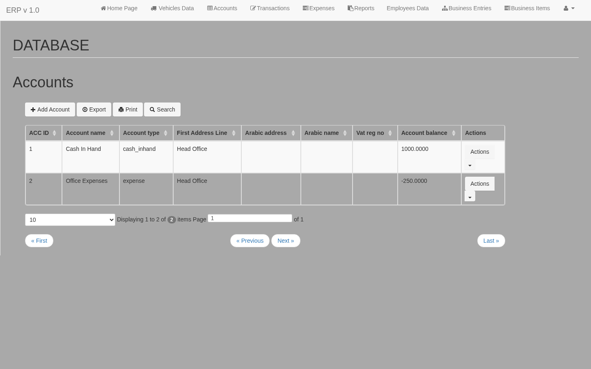
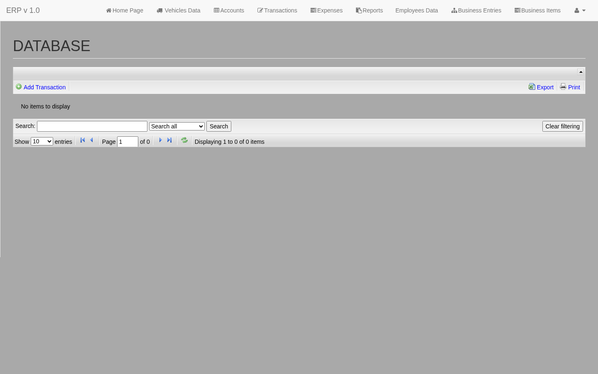

# XYZ Corp — Accounts & Operations System

      

A legacy web application for running the day-to-day accounts and operations of a
small business: chart of accounts, transactions, client invoices (incl. VAT),
salaries, employees, vendor contracts and management reports, with optional
operations modules (vehicles, rentals, trips) enabled per deployment. Bilingual
(English + Arabic).

It was written and maintained by the author from **2016 to 2022** and deployed at
a few small setups, each using a different set of modules. This repository is the
preserved copy, wrapped with a working local environment so it can be run, tested
and studied.

> **Status:** source-complete and runs locally via Docker. The application source is
> preserved here; **no client or financial data is included or retained** — see
> [Database](#database).
>
> **This is a study/reference copy, not production-hardened.** Several layers have
> been simplified or removed (notably authorization, for simplicity) — see
> [docs/AUTHENTICATION](docs/AUTHENTICATION.md).

---

## Stack

| Layer | Technology |
|---|---|
| Language | PHP 7.4 |
| Framework | CodeIgniter 3.1.13 (MVC) |
| CRUD scaffolding | Grocery CRUD 1.6.4 |
| Database | MySQL (developed against 5.6; container uses 5.7) |
| Front end | Bootstrap 3 + SB Admin 2 theme, jQuery, jQuery UI, metisMenu |
| Local runtime | Docker + Docker Compose |

See [`docs/THIRD-PARTY.md`](docs/THIRD-PARTY.md) for licences of bundled libraries.



---

## Screenshots

| Login | Dashboard |
|---|---|
|  |  |

| Accounts (CRUD) | Transactions (CRUD) |
|---|---|
|  |  |

---

## Documentation

| Document | What it covers |
|---|---|
| [docs/ARCHITECTURE](docs/ARCHITECTURE.md) | Request flow, auth, multi-tenant DB, assets |
| [docs/AUTHENTICATION](docs/AUTHENTICATION.md) | Login-only access (authorization removed for simplicity) |
| [docs/MODULES](docs/MODULES.md) | Every controller and model |
| [docs/DATABASE](docs/DATABASE.md) | Tables + ERD |
| [docs/STRUCTURE](docs/STRUCTURE.md) · [docs/FILE_CATALOG](docs/FILE_CATALOG.md) | Tree + full file inventory |
| [docs/TESTING](docs/TESTING.md) · [docs/DEPLOYMENT](docs/DEPLOYMENT.md) | Run & verify |
| [docs/SECURITY](docs/SECURITY.md) · [docs/THIRD-PARTY](docs/THIRD-PARTY.md) | Legacy security notes, licences |
| [docs/GLOSSARY](docs/GLOSSARY.md) | Terms used across the docs |
| [docs/](docs/README.md) | Documentation hub (including rendered diagrams) |

---

## Quick start (Docker)

Requirements: Docker Engine + Docker Compose.

```bash
cp .env.example .env      # only needed the first time
make up                   # or: docker compose up -d --build
```

Then open:

| Service | URL | Credentials |
|---|---|---|
| Application | http://localhost:8080 | `admin` / `admin123` |
| phpMyAdmin | http://localhost:8081 | `root` / `root_password` (from `.env`) |
| MySQL (from host) | `localhost:3307` | `xyz_user` / `xyz_password` |

Stop / reset:

```bash
make down                 # stop containers
make reset                # stop and DELETE the volume (re-runs schema + seed)
make logs                 # tail application logs
```

The database is created automatically on first boot from `db/init/`:
`01-schema.sql` (18 tables) and `02-seed.sql` (a couple of test accounts and
login users). No client or financial data is included.

---

## Database

This repository ships **only a synthetic schema and seed** (`db/init/`). No client
or financial data is included or retained.

If you have your own dump and want to run against it locally, place it under
`db/private/` (git-ignored) and import it:

```bash
cp /path/to/your/backup.sql db/private/backup.sql
make load-backup          # imports it into the running container
```

For safe testing, use the synthetic seed (`make reset`) instead.

Configuration is entirely environment-driven (no credentials in code):

| Variable | Purpose |
|---|---|
| `APP_BASE_URL`, `APP_ENCRYPTION_KEY`, `APP_SESS_SAVE_PATH` | CodeIgniter app config |
| `DB_HOST`, `DB_PORT`, `DB_NAME`, `DB_USER`, `DB_PASSWORD` | Database connection |
| `MYSQL_ROOT_PASSWORD` | MySQL container root user |
| `DB_<GROUP>_USER` / `DB_<GROUP>_PASSWORD` | Optional per-group overrides (see below) |
| `MAIL_*` | Optional SMTP settings |

---

## Authentication & multi-tenant connections

Login is validated against `tb_sf_login`. Each login row carries a `db_user`
value that selects a **database connection group** (`application/config/database.php`),
so each client account could connect as its own MySQL user. All groups are
defined and can be pointed at one account, or given distinct credentials through
the `DB_<GROUP>_*` variables.

> **Legacy note:** passwords are stored as **unsalted MD5** — a 2016-era choice,
> not current best practice. Kept as-is so existing data still authenticates; see
> [`docs/ARCHITECTURE.md`](docs/ARCHITECTURE.md#security-notes).

---

## Project layout

```
.
├── index.php                  # CodeIgniter front controller
├── system/                    # CodeIgniter 3.1.13 framework core
├── application/               # application code (MVC)
│   ├── config/                # environment-driven configuration
│   ├── controllers/            # 24 controllers (one per module + auth)
│   ├── models/                # CRUD/query models
│   ├── libraries/             # GroceryCRUD, image_moo
│   ├── views/                 # admin layout, screens, reports, Arabic I18N
│   └── logs/, cache/          # runtime (ignored)
├── assets/
│   ├── grocery_crud/          # GroceryCRUD assets (incl. `bootstrap` theme)
│   ├── jquery_ui/, print_jq/  # jQuery UI + print-this plugin
│   ├── css/                   # project stylesheet
│   └── uploads/files/         # runtime upload targets (ignored)
├── admin_resources/           # SB Admin 2 front-end theme
├── imgs/, resources/          # logos / misc web-root assets
├── db/
│   ├── init/                  # schema + synthetic seed (Docker init)
│   └── private/               # real backups (git-ignored)
├── docker/                    # Apache/PHP/entrypoint config
├── scripts/                   # helper scripts
├── Dockerfile
└── docker-compose.yml
```

More detail: [`docs/ARCHITECTURE.md`](docs/ARCHITECTURE.md) ·
[`docs/DATABASE.md`](docs/DATABASE.md) · [`docs/MODULES.md`](docs/MODULES.md) ·
[`docs/TESTING.md`](docs/TESTING.md).

---

## Notable fixes applied to this copy

This copy was incomplete (the framework core, front-end theme and GroceryCRUD
assets had been left out). The following were reconstructed or corrected to make
it runnable, **without changing the application's logic**:

- Restored the CodeIgniter 3.1.13 core (`system/`, `index.php`).
- Restored GroceryCRUD `assets/grocery_crud/` and the `bootstrap` theme.
- Restored the SB Admin 2 admin theme, jQuery UI and printThis assets.
- Moved all credentials, SMTP settings and the base URL into environment variables.
- Replaced hard-coded production URLs (`http://<host>/...`) with `base_url()`.
- Removed a `sleep(20)` on every login request.
- Removed 408 Windows `:Zone.Identifier` junk files.
- **De-branded** the app to a placeholder company (`XYZ Corp`, DB `xyz_corp_db`).
- **Reduced to a single authentication layer** — the role/permission layer was
  removed for simplicity (see [`docs/AUTHENTICATION.md`](docs/AUTHENTICATION.md)).

See [`docs/CHANGELOG-restoration.md`](docs/CHANGELOG-restoration.md) for the complete,
itemised log of every change.

---

## Licence

**Study-only — source-available, not open source.** This application and its
source are published for **non-commercial study, testing and evaluation** (see
[`LICENSE`](LICENSE)). You may view, run, test, self-host and share the code for
those purposes; you may **not** use it commercially or in production, or present
it as your own work. It was written and maintained by the author (2016–2022) and
is preserved here as a reference implementation.

Bundled third-party libraries (CodeIgniter, Grocery CRUD, SB Admin 2, jQuery,
jQuery UI, printThis, …) remain under their own licences — see
[`docs/THIRD-PARTY.md`](docs/THIRD-PARTY.md).
