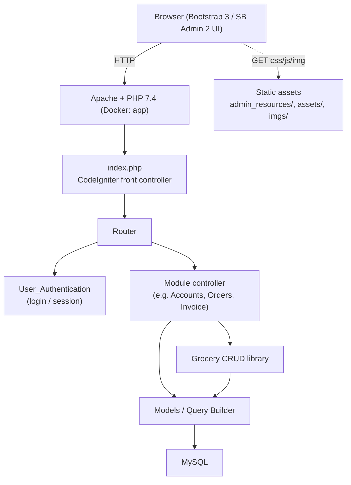

# Architecture

## Overview

`xyz-corp-accounts` is a classic **CodeIgniter 3 MVC** application. Almost every
business module is a CRUD screen built with **Grocery CRUD**, which generates
list/add/edit/delete/read views from a database table with minimal code. A few
screens (invoices, VAT invoices, salary slips, reports) are custom controllers
and views.

## Request lifecycle

1. All requests enter through `index.php` (the CodeIgniter front controller;
   `index_page = 'index.php'`, so URLs look like `/index.php/<Controller>/<method>`).
2. `application/config/routes.php` maps the URI to a controller, defaulting to
   `welcome`.
3. Module controllers check the session (`logged_in`) and, when present, select a
   database connection group before loading their Grocery CRUD model.
4. Grocery CRUD renders the screen; custom actions render views under
   `application/views/`.

## Authentication & sessions

- `User_Authentication` renders the login form and processes `user_login_process`.
- Credentials are validated by `Login_database` against `tb_sf_login`
  (`sf_name` + MD5 of the password — legacy storage, see [SECURITY](SECURITY.md)).
- On success the user's identity, role, `db_user` and `acnt_id` are stored in the
  session (`logged_in`), and the session id is regenerated
  (`sess_regenerate`) to prevent fixation. `logout` destroys the session.
- Sessions use the CodeIgniter `files` driver; the save path is configurable via
  `APP_SESS_SAVE_PATH` (defaults to `/tmp`).

## Authorization (removed)

This working copy enforces **authentication only**. The role/permission (RBAC)
layer of an earlier revision — a policy file, an `Authorization` engine, per-role
row-level scoping and menu gating — was **removed for simplicity**, so every
logged-in user can reach every module. See
[AUTHENTICATION](AUTHENTICATION.md#authorization-was-removed-for-simplicity).

## Multi-tenant database connections

`application/config/database.php` defines several connection groups
(`default`, `appuser`, `readonly`, `acctmgr`, `appadmin`, `cruonly`). The value in
`tb_sf_login.db_user` selects which group a logged-in user connects with, so each
client could be provisioned its own MySQL account and privileges. For local
testing all groups fall back to `DB_USER` / `DB_PASSWORD`; distinct accounts can
be supplied via `DB_<GROUP>_USER` / `DB_<GROUP>_PASSWORD`.

## Configuration

All environment-specific values are read with `getenv()`:

| File | Reads |
|---|---|
| `application/config/config.php` | `APP_BASE_URL`, `APP_ENCRYPTION_KEY`, `APP_SESS_SAVE_PATH` |
| `application/config/database.php` | `DB_*` (shared + per-group) |
| `application/config/email.php` | `MAIL_*` |

No credentials are stored in the repository; `.env` is git-ignored.

## Front-end assets

| Path | Source |
|---|---|
| `admin_resources/` | SB Admin 2 (Bootstrap 3 admin theme) + jQuery 3.5.1 |
| `assets/grocery_crud/` | Grocery CRUD 1.6.4 assets and themes (`bootstrap`, `datatables`, `flexigrid`) |
| `assets/jquery_ui/`, `assets/print_jq/` | jQuery UI and printThis plugin |
| `imgs/`, `resources/`, `assets/css/` | project logos and stylesheets |

## Security notes

This is a faithful restoration of a 2016–2022 application. Two legacy practices
are preserved for data compatibility and are **called out, not hidden**:

- **Password storage:** unsalted MD5 in `tb_sf_login.sf_password`.
- **Query construction:** `Login_database` builds a `WHERE` string by
  concatenation; input is passed through CodeIgniter's escaping for normal CRUD,
  but the login path is not parameterised.

If this code were ever to be modernised, those two items plus enabling CSRF
(`$config['csrf_protection']`) and setting a real `encryption_key` would be the
first changes. They are left untouched here so the original behaviour and data
remain intact.

## Why Docker

The app targets PHP 7.4 + MySQL 5.x, both end-of-life. The container pins a
working PHP 7.4/Apache image (using the frozen Debian snapshot the base image
references, since bullseye sockets are archived) and MySQL 5.7, so the legacy
stack runs reproducibly on a modern machine.
