# Database

Database name (container): `xyz_corp_db`. The schema is created from
`db/init/01-schema.sql`; `db/init/02-seed.sql` adds a small amount of synthetic
test data. The real, production dump is **not** in this repository.

- **18 tables**, InnoDB, `utf8` / `latin1` mix as per the original dump.
- Central entity: **`tb_accounts`** — the chart of accounts, and also the party
  table (clients, vendors, owners, expense and cash accounts). Most foreign keys
  point at it.

## Entity relationship diagram

```mermaid
erDiagram
    tb_accounts          ||--o{ tb_employees          : "account_id"
    tb_accounts          ||--o{ tb_expenses           : "account_id"
    tb_accounts          ||--o{ tb_investments        : "owner_account"
    tb_accounts          ||--o{ tb_orders             : "client_id"
    tb_accounts          ||--o{ tb_profits            : "account_id"
    tb_accounts          ||--o{ tb_salaries           : "account_id"
    tb_accounts          ||--o{ tb_transactions       : "account_from"
    tb_accounts          ||--o{ tb_transactions       : "account_to"
    tb_accounts          ||--o{ tb_vehicles           : "account_id"
    tb_accounts          ||--o{ tb_vendor_contracts   : "vendor_id"
    tb_accounts          ||--o{ tb_assignment_co      : "company_Id"
    tb_accounts          ||--o{ tb_assignment_co      : "coordinator_Id"
    tb_accounts          ||--o{ tb_callout_trips      : "driver_id"
    tb_accounts          ||--o{ tb_callout_trips      : "vendor_id"
    tb_accounts          ||--o{ tb_rental_equipments  : "vendor_id"
    tb_orders            ||--o{ tb_callout_trips      : "order_id"
    tb_orders            ||--o{ tb_contract_items     : "order_id"
    tb_orders            ||--o{ tb_rental_equipments  : "order_id"
    tb_arbdescription    ||--o{ tb_callout_trips      : "arbdes_id"
    tb_vendor_contracts  ||--o{ tb_vendor_items       : "contract_id"
```



## Tables

| Table | Cols | Purpose |
|---|---:|---|
| `tb_accounts` | 16 | Chart of accounts / parties (clients, vendors, owners, expense, cash). Central table. |
| `tb_arbdescription` | 3 | English ⇄ Arabic description lookup. |
| `tb_arblocation` | 3 | English ⇄ Arabic location lookup. |
| `tb_assignment_co` | 6 | Assignment companies and coordinators (FK → `tb_accounts`). |
| `tb_callout_trips` | 21 | Trip records (order, vendor, driver, vehicle, Arabic description). |
| `tb_contract_items` | 8 | Line items belonging to orders (FK → `tb_orders`). |
| `tb_employees` | 20 | Employees and their documents (photo, iqama, passport, …). |
| `tb_expenses` | 9 | Expense entries per account. |
| `tb_investments` | 7 | Investment / equity entries per owner account. |
| `tb_orders` | 13 | Client orders. |
| `tb_profits` | 5 | Profit entries per owner account. |
| `tb_rental_equipments` | 13 | Rental equipment per order/vendor. |
| `tb_salaries` | 7 | Salary slips per account. |
| `tb_sf_login` | 7 | Application users; `db_user` selects the DB connection group. |
| `tb_transactions` | 7 | Account-to-account transactions (from/to). |
| `tb_vehicles` | 16 | Vehicles and their documents. |
| `tb_vendor_contracts` | 6 | Vendor contracts. |
| `tb_vendor_items` | 8 | Items under a vendor contract (FK → `tb_vendor_contracts`). |

## Seeded test data

`db/init/02-seed.sql` inserts:

- **Login users:** `admin` / `admin123` (role `admin`) and
  `accountant` / `accountant123` (role `standard`).
- **Accounts:** `Cash In Hand` and `Office Expenses`.

Everything else starts empty; Grocery CRUD screens can create rows via the UI.

## Notes

- `tb_sf_login.db_user` values map to connection groups in
  `application/config/database.php` (see [ARCHITECTURE](ARCHITECTURE.md)).
- Column counts above are from the live container; re-check any time with:

  ```bash
  docker compose exec -T db mysql -uroot -p"$MYSQL_ROOT_PASSWORD" -N \
    -e "SELECT TABLE_NAME, COUNT(*) FROM information_schema.COLUMNS \
        WHERE TABLE_SCHEMA='xyz_corp_db' GROUP BY TABLE_NAME"
  ```
