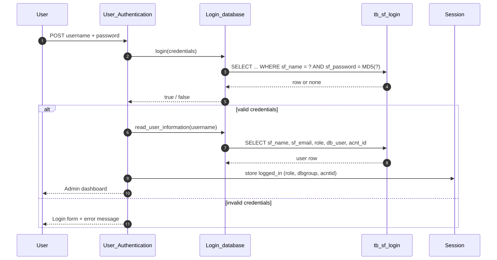

# Documentation

Hub for the `xyz-corp-accounts` documentation. Start at the top-level
[README](../README.md) for a quick start, then dive in here.

| Document | What it covers |
|---|---|
| [ARCHITECTURE](ARCHITECTURE.md) | Request lifecycle, MVC, auth, multi-tenant DB, assets |
| [MODULES](MODULES.md) | Every controller and model, and what it does |
| [DATABASE](DATABASE.md) | Tables, entity-relationship diagram, seed data |
| [STRUCTURE](STRUCTURE.md) | Directory tree + hierarchy diagram |
| [FILE_CATALOG](FILE_CATALOG.md) | Complete file inventory |
| [TESTING](TESTING.md) | How to verify the app (smoke test, manual checks) |
| [DEPLOYMENT](DEPLOYMENT.md) | Running and deploying the Docker stack |
| [DEVELOPMENT](DEVELOPMENT.md) | Conventions and how to add a module |
| [AUTHENTICATION](AUTHENTICATION.md) | Login-only access; why authorization was removed |
| [SECURITY](SECURITY.md) | Legacy security posture and remediation notes |
| [THIRD-PARTY](THIRD-PARTY.md) | Bundled libraries and their licences |
| [CHANGELOG-restoration](CHANGELOG-restoration.md) | Complete, itemised log of every change made |
| [GLOSSARY](GLOSSARY.md) | Terms used across the documentation |

## Diagrams

Rendered SVGs live in [`assets/`](assets/) and the editable Mermaid sources in
[`diagrams/`](diagrams/). Regenerate with `make render-docs`.

| Diagram | Preview |
|---|---|
| Architecture |  |
| Deployment |  |
| Login sequence |  |
| Modules |  |
| Directory structure |  |
| Database ERD |  |
